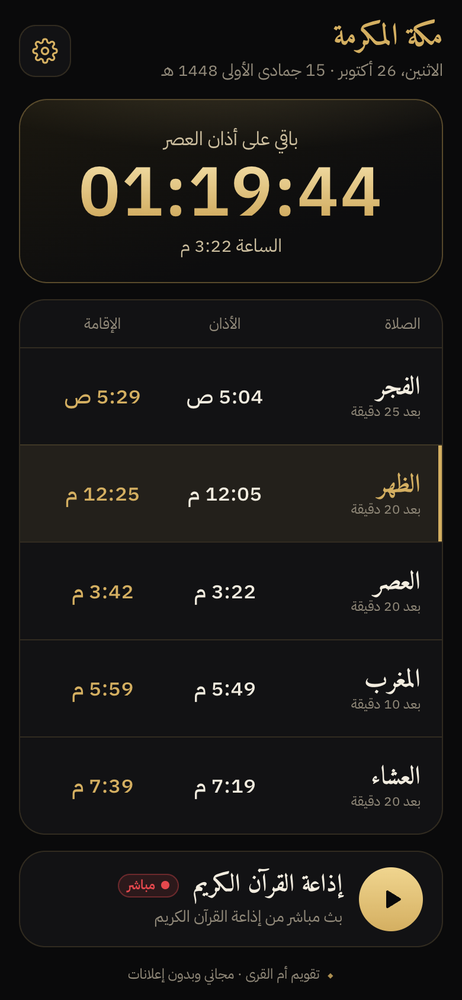
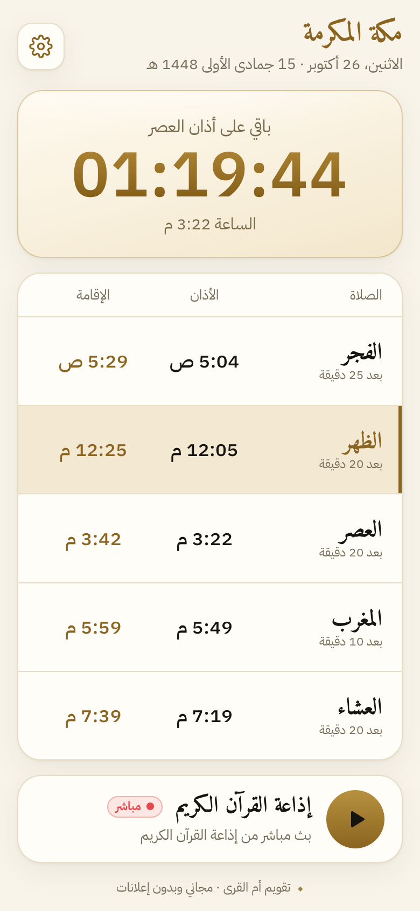
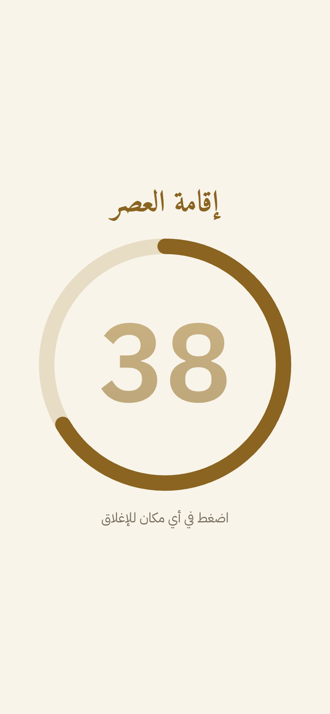
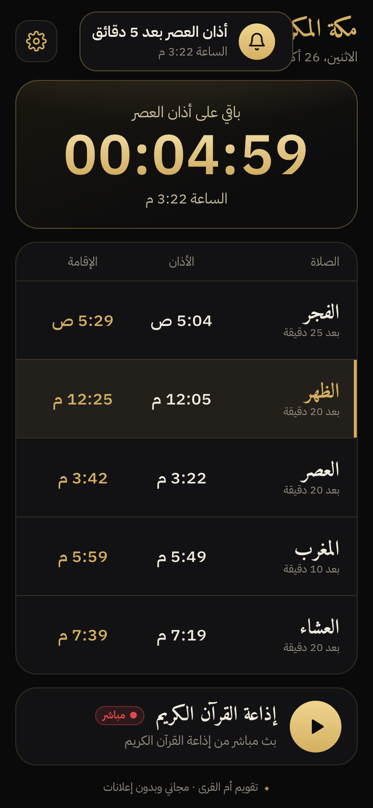
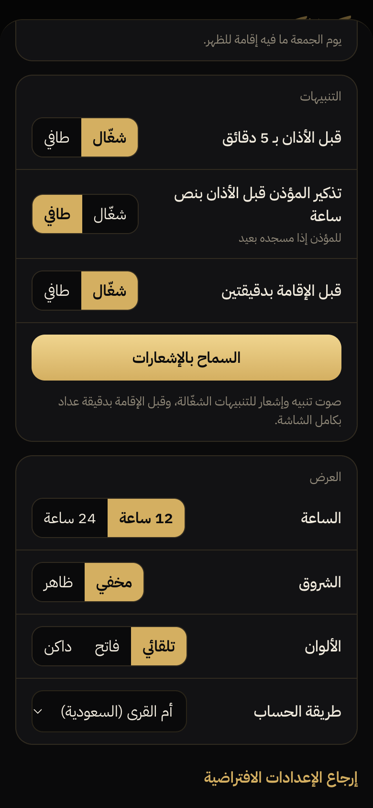
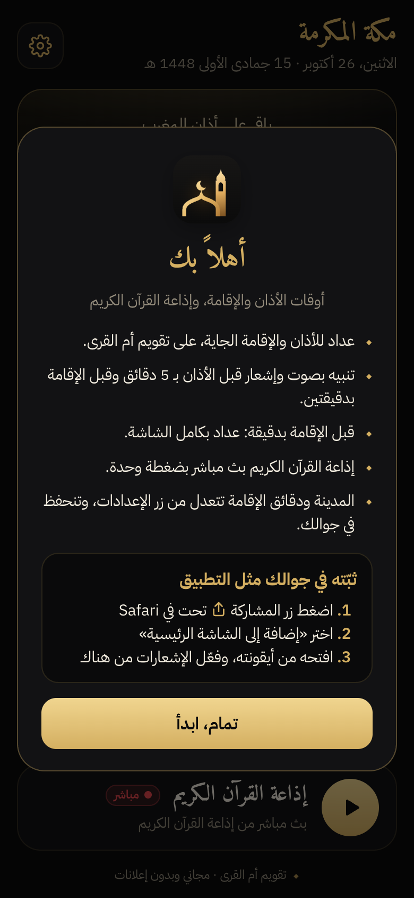
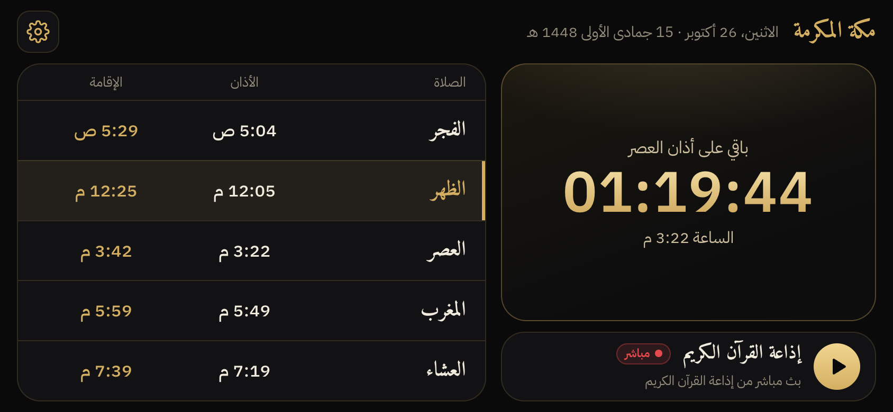
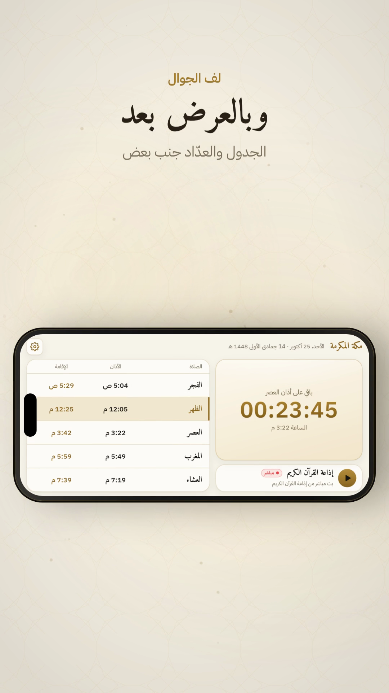

<div dir="rtl">


# أوقات الأذان والإقامة

موقع مجاني لأوقات الأذان والإقامة وإذاعة القرآن الكريم، يتثبّت في الجوال مثل التطبيق. انسوّى لمؤذن عشان يعرف متى يأذن ومتى يقيم، ويناسب أي بيت. بدون إعلانات، وبدون حسابات.

**الرابط: https://adhan-iqama.pages.dev**

<p>



</p>

## وش فيه

- **عداد** للأذان أو الإقامة الجاية، وجدول اليوم: وقت الأذان ووقت الإقامة لكل صلاة.
- **تقويم أم القرى**: يُحسب في الجوال نفسه وبدون نت، والعشاء في رمضان بعد المغرب بساعتين. مطابق لجدول مكة الرسمي (37 من 40 وقت بالدقيقة، والباقي بفرق دقيقة).
- **الإقامة**: الفجر 25، الظهر 20، العصر 20، المغرب 10، العشاء 20 دقيقة، وكلها تتعدّل. يوم الجمعة «الجمعة» وما فيه إقامة.
- **قبل الإقامة بدقيقة** عداد بكامل الشاشة، وبعده «حان وقت الإقامة».
- **إشعارات** حتى والتطبيق مقفل:
  - قبل الأذان بـ 5 دقائق (شغّال افتراضياً).
  - تذكير المؤذن قبل الأذان بنص ساعة، لو مسجده بعيد (طافي افتراضياً).
  - قبل الإقامة بدقيقتين (شغّال افتراضياً).
- **إذاعة القرآن الكريم** بث مباشر بضغطة، وتبدأ بسرعة.
- **فاتح وداكن** بالأسود والذهبي، ويشتغل **بالطول والعرض**.
- **بدون نت** يفتح ويعرض الأوقات (الإذاعة والإشعارات تحتاج نت).
- الإعدادات تنحفظ في جوالك بس.

<p>



</p>


## التثبيت على الآيفون

1. افتح **https://adhan-iqama.pages.dev** في **Safari**.
2. اضغط زر المشاركة، ثم «إضافة إلى الشاشة الرئيسية».
3. افتحه من الأيقونة، واضغط «السماح بالإشعارات».

الإشعارات في الآيفون تحتاج iOS 16.4 أو أحدث، وتشتغل بس لما يكون مثبّت على الشاشة الرئيسية.

## فيديو تعريفي

فيديو 55 ثانية يشرح التطبيق، طولي (1080×1920) ومربع (1080×1080): من صفحة [Releases](../../releases/latest).





## كيف يشتغل

كله على Cloudflare بالخطة المجانية:

| الجزء | المكان | وش يسوي |
|---|---|---|
| الموقع | `public/` | صفحة وحدة `index.html` بدون أي إطار عمل، ومكتبة [adhan](https://github.com/batoulapps/adhan-js) لحساب الأوقات، و`sw.js` للعمل بدون نت والإشعارات |
| الإذاعة | `functions/radio.js` | يجيب رابط البث المباشر مسبقاً عشان يبدأ الصوت بسرعة |
| الاشتراك | `functions/api/subscribe.js` | يحفظ اشتراك الإشعارات وإعدادات الجوال في D1 |
| الإشعارات | `worker/` | Worker يشتغل كل دقيقة، يحسب أوقات كل مشترك بنفس قواعد الصفحة، ويرسل Web Push مشفّر (RFC 8291 و VAPID) |
| قاعدة البيانات | `schema.sql` | جدول `subs` واحد في D1 |
| الفيديو | `video/src/` | مشاهد HTML بخط زمني واحد، تتصوّر إطار إطار وتنضغط بـ ffmpeg |

```
public/            الموقع (يُرفع كما هو)
functions/         دوال Cloudflare Pages: radio و api/subscribe
worker/            Worker الإشعارات: src/ والاختبارات test/
schema.sql         جدول الاشتراكات
wrangler.toml      إعداد Pages وربط D1
video/src/         مصدر الفيديو التعريفي و render.sh
docs/screenshots/  صور الريدمي
```

## التطوير

<div dir="ltr">

```sh
# Run the site locally with its functions and a local D1
npx wrangler d1 execute adhan-push --local --file schema.sql
npx wrangler pages dev                       # http://localhost:8788

# Push worker tests (Web Push crypto vectors, prayer schedule, settings)
cd worker && npm test
```

</div>

## النشر

<div dir="ltr">

```sh
# 1. Database (once), then put its id in wrangler.toml and worker/wrangler.toml
npx wrangler d1 create adhan-push
npx wrangler d1 execute adhan-push --remote --file schema.sql

# 2. Site + functions
npx wrangler pages deploy --branch main

# 3. Notification worker and its VAPID keys (once). The public key must match public/push.js.
cd worker
npx wrangler secret put VAPID_PUBLIC
npx wrangler secret put VAPID_PRIVATE
npx wrangler secret put VAPID_SUBJECT       # e.g. https://adhan-iqama.pages.dev
npx wrangler deploy
npx wrangler tail adhan-push                # watch the sends
```

</div>

بعد أي تعديل على الموقع، غيّر رقم `CACHE` في `public/sw.js` عشان الجوالات تاخذ النسخة الجديدة. ولو تبغى تسوي نسختك الخاصة، سوّ مفاتيح VAPID جديدة (مثلاً `npx web-push generate-vapid-keys`)، وحط العام في `public/push.js` والخاص في أسرار الـ Worker، وخلّ الخاص في `worker/.dev.vars` محلياً بس.

## الفيديو

<div dir="ltr">

```sh
cd video/src && ./render.sh        # capture the live UI → frames → MP4 (vertical + square), ~10 min
```

</div>

## شكر

- [adhan-js](https://github.com/batoulapps/adhan-js) من Batoul Apps (MIT) لحساب الأوقات.
- البث المباشر لإذاعة القرآن الكريم السعودية.
- خط [Amiri](https://fonts.google.com/specimen/Amiri) و [IBM Plex Sans Arabic](https://fonts.google.com/specimen/IBM+Plex+Sans+Arabic) (OFL) من Google Fonts.

## الرخصة

[MIT](LICENSE). مكتبة adhan برخصتها MIT في `public/LICENSE-adhan.txt`.

</div>
